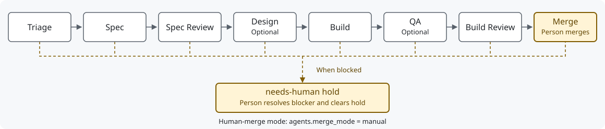

# Bureau

[](LICENSE)

Bureau takes Linear tickets through specification, implementation, QA and code review, with Spec Kit artifacts tracking the work. It installs skills, project instructions and pipeline scripts into your Git repository for Codex app tasks, Claude Code sessions or background provider CLIs. State lives in Linear and Git; there is no application backend to host.



The diagram shows human-merge mode; Design and QA run when enabled. A `needs-human` hold pauses background pickup until a person resolves the blocker and removes the label. See the [stage protocol](docs/stage-protocol.md) and [state setup](references/setup.md).

## Safety model

- **A person merges:** set `agents.merge_mode: "manual"` and configure a Merge state to park approved work for a human. The default is `auto`, so select manual mode explicitly. See [merge authority](docs/adr/0002-explicit-merge-authority.md).
- **Secrets stay filtered:** branch-controlled code runs with Bureau service secrets and their environment carriers removed. This filters the environment; it does not hide files readable by the same account. See [environment filtering](docs/configuration.md#repo).
- **Each background run owns a disposable worktree:** workers claim the ticket and checkout before running; held branches and unfinished work are preserved. App tasks use their current checkout. See [workspace isolation](docs/stage-protocol.md).

## Requirements

| Dependency | Needed for |
|---|---|
| Python 3.9+, Bash 3.2+, Git 2.26+, jq, curl | Installation and shared runtime. The shell filter needs Python on the system default PATH and `env` with `-0`; merge-only worker reuse needs Git 2.38+ |
| `specify-cli` 1.2.2 (`uv tool install specify-cli==1.2.2`) | Spec Kit initialization and resync, pinned by the installer |
| Linear account and `LINEAR_API_KEY` in ignored `.env` | Shared ticket reads and transitions |
| GitHub CLI (`gh`), authenticated | PR creation and merge operations |
| Claude CLI and/or Codex CLI, authenticated | Providers selected for background stages; no provider CLI is required for a current Codex app task |
| tmux | Persistent pane launchers; app tasks and one-shot ticks do not need it |
| Node.js 18+ | Shared conflict-schedule CLI |

See [setup prerequisites](references/setup.md) and [provider configuration](docs/provider-runtime.md). Keep credentials out of tracked files; shell helpers call Linear's API directly.


## Install

Keep one source clone at the published `v3.6.0` tag and expose it to the assistants you use. See [release status](docs/releases.md#current-release-status) for validation and limitations.

```sh
git clone --branch v3.6.0 --single-branch https://github.com/KaiaK808/bureau.git "$HOME/bureau-init"
mkdir -p "$HOME/.agents/skills"
ln -s "$HOME/bureau-init" "$HOME/.agents/skills/bureau-init"
# Optional Claude Code entry point:
mkdir -p "$HOME/.claude/skills"
ln -s "$HOME/bureau-init" "$HOME/.claude/skills/bureau-init"
```

Preserve existing installations and links. This clone is pinned in detached-HEAD state; upgrades select another published tag. In an adopting Git repository, invoke `$bureau-init --target codex`, `/bureau-init --target claude`, or `--target both`. For both, choose the active Spec Kit integration. Refresh skill discovery after installation.

The installer discovers Linear settings, writes `.bureau.json`, initializes pinned Spec Kit and installs the selected interfaces and runtime assets. Codex uses `.agents/skills` and AGENTS.md; Claude uses `.claude/commands`, `.claude/skills` and CLAUDE.md. Resync preserves user instructions and the constitution; `.bureau-install.json` records customization hashes and source revisions. See the [setup procedure](references/setup.md) for agent selection, optional CI and installed assets.

## Choose how to work

Replace `ISSUE` with your Linear issue key.

| Mode | Where creative work runs | Entry point |
|---|---|---|
| Codex app task | Current task, using its selected model and tools | `$bureau ISSUE through review` |
| Claude interactive | Current Claude Code session | `/linear-to-spec ISSUE`, `/linear-implement ISSUE` |
| Bounded background tick | Configured provider CLI in a claimed disposable worktree | `bash scripts/bureau-tick.sh --no-merge` |
| Continuous background pipeline | Configured provider CLIs, supervised dispatcher/tmux | `bash scripts/start-bureau-v2.sh` |

App review and bounded ticks stop before merge by default. Background pipelines in auto merge mode can merge after approval and the complete CI/base gate; `--no-merge` preserves a review-only boundary. Codex support has local fixture coverage; [qualify a representative live ticket](docs/codex-acceptance.md) before unattended adoption.

## Work in a Codex app task

Use `$bureau spec ISSUE`, `$bureau implement ISSUE`, `$bureau qa ISSUE`, `$bureau review ISSUE`, or `$bureau ISSUE through review`. These work in the current task without launching a nested model. `$bureau status` inspects ownership and saved runs; `$bureau resume RUN_ID` continues preserved work.

The [app setup guide](templates/skills/bureau/references/app-setup.md) supplies setup/status/test actions for app settings. Set `repo.test_command` to the project's real tests. The app generates its own local-environment configuration; Bureau preserves unrelated `.codex` settings.

The [stage protocol](docs/stage-protocol.md) checks state IDs, ownership, current HEAD, canonical branch and completion evidence before advancing a ticket. A review request stops at review; explicitly authorized automated merging still uses the complete merge gate.

## Background execution

Set `agents.runner` to `claude` (legacy default) or `codex`; individual stages can select another runner. Use [provider-specific model settings](docs/provider-runtime.md) when mixing providers.

```sh
# Read-only checks, then one bounded stage:
python3 scripts/bureau-doctor.py --mode background
bash scripts/bureau-tick.sh --no-merge
# One named ticket through review:
bash scripts/shepherd.sh --no-tmux --no-merge ISSUE
# Pause future dispatch; existing work finishes normally:
python3 scripts/bureau-runtime.py pause
python3 scripts/bureau-runtime.py unpause
```

`logs/bureau-tick.json` distinguishes waits, advancement, Done, review boundaries and failures; provider evidence lives under `logs/provider-runs/`. Missing usage or cost means unavailable, not zero. The [supervision guide](templates/skills/bureau/references/supervision.md) covers notifications, requested app scheduling and conflict scheduling. Installation does not start recurring automation.

The tmux launchers run one continuous dispatcher with two lanes by default. Startup requires explicit `agents.file_overlap_gate: true`, even for one lane or dry-run; otherwise it exits 24. Update all writers together before enabling it. `agents.parallel_lanes` controls process lanes separately from the ticket cap. See [continuous dispatch](docs/stage-protocol.md#continuous-ticket-dispatch).

| Operation | Entry point |
|---|---|
| Preview a batch schedule | `bash scripts/orchestrate.sh --execute --schedule schedule.json --max-concurrent 3 --no-merge --dry-run` |
| Execute that reviewed schedule | Repeat without `--dry-run`; a review stop halts its serial lane |
| Port an upstream change | `bash scripts/upstream-port.sh --sha COMMIT` or `--pr NUMBER`, after configuring the upstream and build/test commands |

The [operations reference](references/operations.md) covers these modes, dry-run limits and multiple repositories. `agents.max_concurrent_issues: 1` limits counted tickets; manual Merge is excluded unless `agents.max_concurrent_include_merge: true`, and Build Review always counts. Ownership and schedule validation remain required.

## Update and migrate

Stop drivers and preserve unfinished work and customizations, update the source tag and refresh discovery, then preview and resync each adopting repository. Keep the existing target selection; the example updates scripts and interfaces for both hosts. Use `/bureau-init` with the same arguments in Claude Code. The [migration guide](docs/migration.md) covers release-specific prerequisites, additional scopes, conflicts, validation and rollback; the [release record](docs/releases.md) lists changes and limits. Updating the clone or running `--update` alone does not refresh installed assets. Restart drivers together and qualify a representative ticket before unattended use.

```text
$bureau-init --resync-interfaces --resync-scripts --target both
```

## Documentation

| Reference | Contents |
|---|---|
| [Configuration](docs/configuration.md) | State maps, stage toggles, provider settings and overrides |
| [Provider runtime](docs/provider-runtime.md) | Auth, permissions, structured results, timeouts and evidence |
| [Operator cheat sheet](docs/OPERATOR-CHEATSHEET.md) | App tasks, one-shot runs and batch scheduling |
| [Exit codes](docs/exit-codes.md) | Failure, quota, ownership and stop outcomes |
| [Recipes](docs/recipes.md) | Single-flight, provider mixing and dry-run examples |
| [Troubleshooting](docs/troubleshooting.md) | Diagnostics, recovery and permissions |
| [Token efficiency](docs/token-efficiency.md) | Optional Claude capabilities and their limits |
| [Upgrade guide](docs/migration.md) | Source update, per-repository resync, conflicts and rollback |
| [Releases](docs/releases.md) | Release status, versioning and publication checklist |
| [Acceptance record](docs/codex-acceptance.md) | Automated coverage and live adoption checks |

The same documents are [available as styled HTML](docs/site/index.html). Contributions follow [AGENTS.md](AGENTS.md) and [CONTRIBUTING.md](CONTRIBUTING.md); see them for source layout and validation.

Built by [Kai Ebert](https://github.com/KaiaK808) / Brainhuggers under the [MIT license](LICENSE). See [SECURITY.md](SECURITY.md), [CODE_OF_CONDUCT.md](CODE_OF_CONDUCT.md) and [NOTICE](NOTICE).
